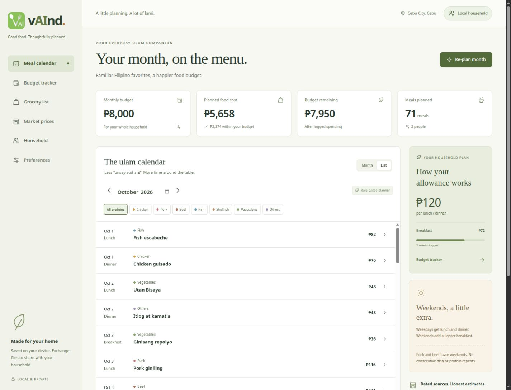
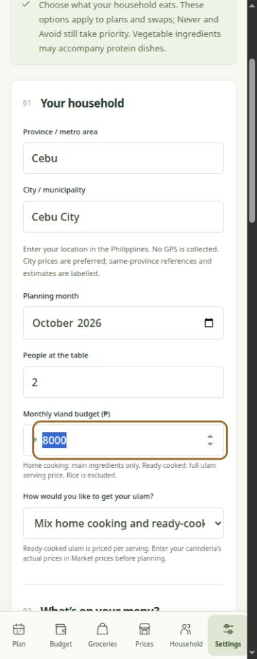
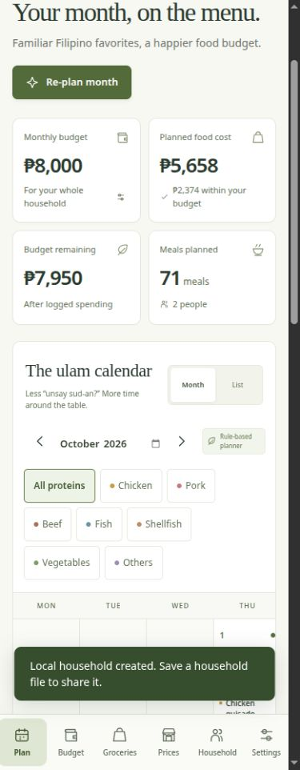
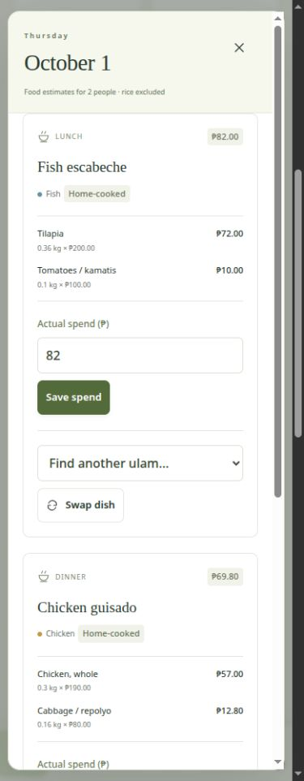
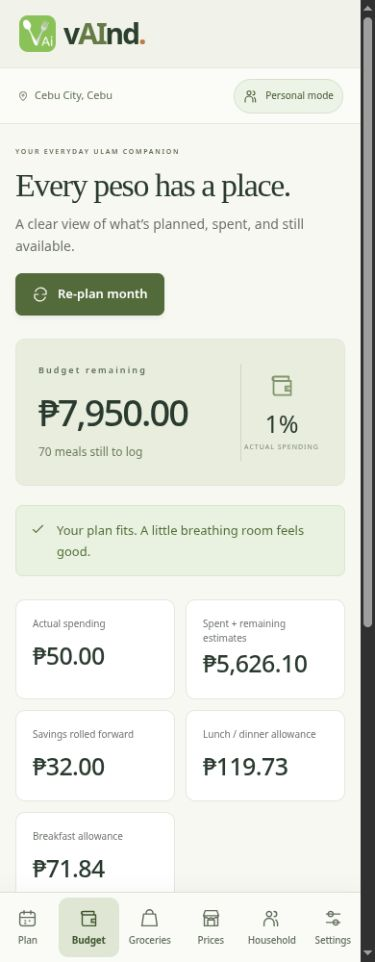
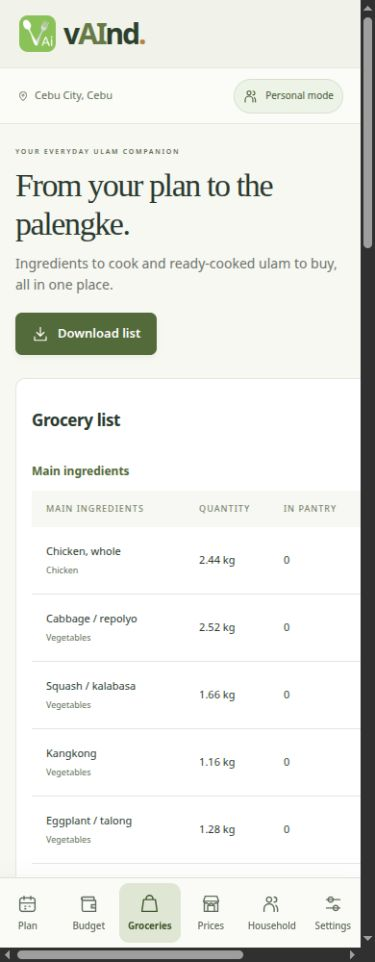
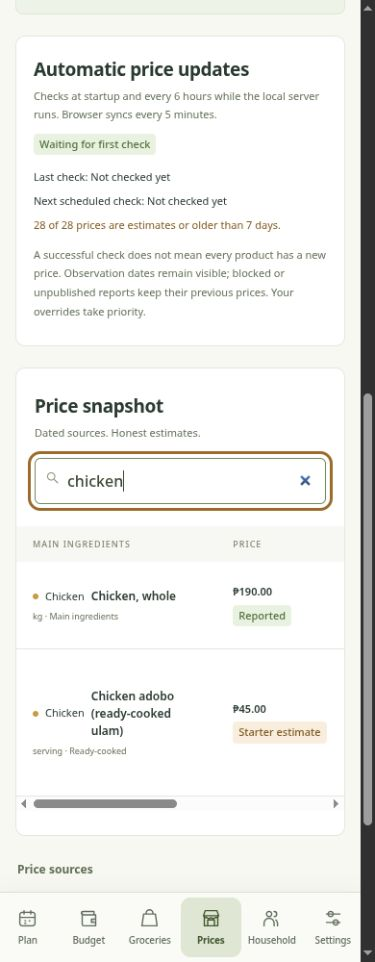
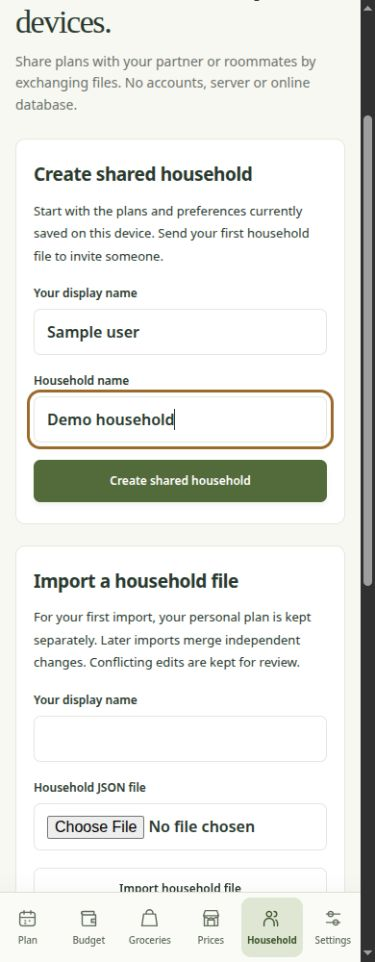
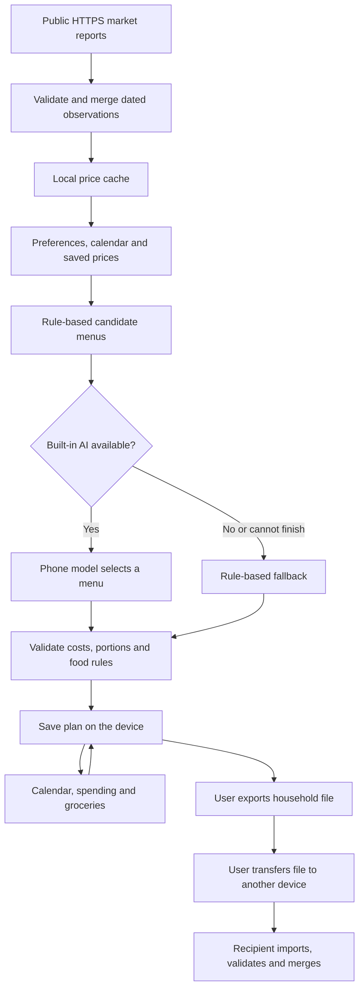

# vAInd

**Good food. Thoughtfully planned.**

A Filipino ulam planner that runs on the user's Android phone. **No Supabase, online database, account, hosting, computer or API key is needed.** Plans, preferences, budgets, spending, pantry and price snapshots use the device's localStorage. The included AI runs on the phone. Optional public market-price checks use the phone's internet connection.

## Contents

- [App interface](#app-interface)
- [Install the phone app](#install-the-phone-app)
- [Daily use](#daily-use)
- [Budget and food rules](#budget-and-food-rules)
- [Partners and roommates without a database](#partners-and-roommates-without-a-database)
- [Prices on the phone](#prices-on-the-phone)
- [Built-in AI](#built-in-ai)
- [How the Android app fits together](#how-the-android-app-fits-together)
- [Storage, privacy and recovery](#storage-privacy-and-recovery)
- [Troubleshooting and current limits](#troubleshooting-and-current-limits)
- [Project files](#project-files)
- [Development and verification](#development-and-verification)
- [Credits](#credits)

## App interface

The interface uses the supplied vAInd logo, a green and cream palette, readable cards and clear peso amounts. Phones have a bottom navigation bar; larger screens use a sidebar. The active section is highlighted, and the header shows the selected location and household status.

### Interface preview

These are captures of the actual web interface with sample data, including a **₱8,000 budget for two people** and one **₱50 sample expense**. They demonstrate the responsive layout, not a physical Android installation. The browser preview shows a rule-based plan; the Android APK adds the included AI and Android file pickers. The browser's price-check wording refers to its development server; APK checks run directly on the phone.



| Preferences and setup | Meal calendar |
| --- | --- |
|  |  |

| Day detail and spending | Budget tracker |
| --- | --- |
|  |  |

| Grocery list | Market prices |
| --- | --- |
|  |  |

| Household file sharing |
| --- |
|  |

Images are stored in `docs/screenshots/` so the README can display them alongside the source. Open an image to inspect it at full size. Sample amounts are illustrative and are not current vendor quotations.

### Screen guide

| Phone tab | Larger-screen label | What you can do |
| --- | --- | --- |
| **Plan** | **Meal calendar** | Review monthly budget cards; switch Month/List views; change month; filter by food category; open meals; create or re-plan a month. |
| **Budget** | **Budget tracker** | See actual spending, remaining funds, committed costs, rollover savings and the recalculated lunch/dinner and breakfast allowances. Review logged meals. |
| **Groceries** | **Grocery list** | Choose the whole month or a seven-day date range; review ingredients and ready-cooked purchases; enter pantry stock; download a CSV shopping list. |
| **Prices** | **Market prices** | Preview prices for an area; search products; inspect dates and sources; check refresh status; save or reset location-specific price overrides. |
| **Household** | **Household** | Create a local household; save and import household JSON files; review members encountered through file exchange; export and leave a household. |
| **Settings** | **Preferences** | Set budget, household size, month, location, cooking mode, category preferences, vegetable/monggo options and avoided ingredients; export or restore a backup. |

**Day detail** opens from a calendar day or meal row. It shows each meal's home/ready-cooked label, ingredients or servings, quantities, listed unit prices and estimated cost. Enter actual spend, update/remove a log, or choose an allowed swap. Logged meals stay locked against swaps until their log is removed.

### Feedback and accessibility

Planning, price checks and file operations show progress or feedback. A planner label identifies whether the included AI or the rule-based planner selected the menu. Price labels distinguish reported observations, estimates and user overrides; observation age remains visible. Invalid entries, infeasible settings, storage failures and import conflicts produce messages rather than an empty screen.

The UI includes labelled fields, grouped preference radios, keyboard navigation, visible focus, a skip link, a modal meal dialog and reduced-motion styling. Tables can scroll horizontally on narrow screens. These are implemented accessibility features; a complete independent WCAG AA audit has not been performed.

## Install the phone app

The current signed release is **`dist/vAInd-1.2.0.apk`**, approximately **494 MB**. Its SHA-256 checksum is supplied in `dist/vAInd-1.2.0.apk.sha256`. Copy it to the phone, open it and tap Install. It targets **64-bit ARM Android 8.0+**, including the Redmi Note 14 family, and needs an up-to-date Android System WebView. Allow your chosen file manager to install the APK if Android asks. No computer connection, certificate installation or server address is part of normal app use.

Build artifacts in `dist/` are excluded from Git. These paths refer to the local build output; no public APK download URL is configured in this README.

Export a backup from Preferences before updating. **Install over the existing vAInd app; do not uninstall first.** Version 1.2.0 uses the original signing key and package ID, so Android can preserve existing local data. Uninstalling or clearing app data removes local copies.

The APK is about **494 MB** because it includes Qwen2.5-0.5B-Instruct Q4_K_M and a CPU-only llama.cpp runtime. First AI use copies and verifies the model in app-private storage. Allow about **1.2 GB free**, plus any additional space the Android installer needs. No model download is needed. Native inference starts only with at least 1.1 GiB available RAM. Physical Redmi performance and Android file-picker behavior still need testing on a real phone; the APK build, signatures, bundled assets and business logic are checked locally.

## Daily use

On first launch, start in **Settings / Preferences**. Review location and price estimates before committing to a month. The same navigation remains available after a plan is saved.

1. Set the month, budget (minimum **₱3,000**), number of people, city/province and food preferences.
2. Choose Often, Sometimes or Never per category. Vegetable-only mains and monggo have independent inclusion switches, so each household can choose. Avoided ingredients apply to recipes and ready-cooked dishes.
3. Create a monthly plan. Weekdays have lunch/dinner; weekends add a lighter breakfast. Main ingredients are costed for home cooking; ready-cooked ulam uses whole vendor servings. Rice is excluded.
4. Open a day to swap an allowed dish or log spending. Unspent money rolls into the remaining weighted meals. Logged meals retain their history.
5. Use the budget tracker and grocery list, enter pantry quantities, and save JSON backups or grocery CSVs through Android's file picker.

Prices are estimates for planning, not guaranteed vendor quotations. In Market prices, check observation dates and enter your own local prices. Ready-cooked prices start as unverified estimates and need your vendor's override.

## Budget and food rules

| Rule | App behavior |
| --- | --- |
| Monthly budget | Accepts **₱3,000–₱1,000,000**. The minimum is an input limit; it does not guarantee that every household size and preference combination is affordable. |
| Household size | Accepts **1–30 people** and scales recipe quantities or ready-cooked servings. |
| Meal schedule | Weekdays: lunch and dinner. Weekends: breakfast, lunch and dinner. |
| Meal weights | Lunch/dinner each weigh **1**; breakfast weighs **0.6** when dividing the remaining allowance. |
| Cost scope | Home cooking: main ingredients only. Ready-cooked: the full vendor ulam serving price. Rice is excluded in both modes. |
| Food preferences | Often increases selection weight; Sometimes remains available; Never excludes ingredients in that category. Often is a preference, not a guaranteed meal quota. |
| Vegetables and monggo | Independent switches allow or exclude vegetable-only mains and monggo dishes. Vegetable ingredients can still accompany protein dishes when allowed by the other exclusions. |
| Variety | Prevents consecutive dish/protein repeats. Pork and beef generally favor weekends. |
| Spend logs | Actual costs replace estimates in the remaining-budget calculation. Zero spend is valid. Logged history remains preserved when preferences change. |
| Ready-cooked food | Uses whole vendor servings. Breakfast uses `ceil(household × 0.6)` servings, with at least one serving. |
| Swaps | Must satisfy the budget, food rules, cooking mode and neighboring meals. Pantry quantities help prioritize suitable swaps. |

The allowance is recalculated as:

```text
Remaining funds = monthly budget − actual logged spending
Remaining weight = unlogged lunch/dinner count + (unlogged breakfast count × 0.6)
Lunch/dinner allowance = remaining funds ÷ remaining weight
Breakfast allowance = lunch/dinner allowance × 0.6
```

For example, **₱6,000 remaining across 60 weighted meals** gives a **₱100 lunch/dinner allowance** and a **₱60 breakfast allowance**. If a meal estimated at ₱120 costs ₱90, the ₱30 saving remains available to the unlogged meals. The allowance is guidance; a valid meal can cost more or less while the complete plan stays within the available budget.

New generated plans are checked against the budget. Actual spending can exceed it; the app retains the honest log and warns instead of hiding the expense. Increase the budget or re-plan affordable remaining meals when needed.

**Avoid ingredients** filters the modelled recipe ingredients. Condiments and vendor variations are not comprehensively listed, so check labels and preparation with the seller when exclusions matter.

## Partners and roommates without a database

Household sharing is **manual file exchange**, not live sync. Each phone owns an independent local copy.

1. On one phone, open Household, enter a display name and household name, then create a household.
2. Tap **Save household file**, save the JSON file on the device and send it using Quick Share, Bluetooth or another method you choose.
3. The other person opens **Household → Import a household file**, enters their display name and selects the received file. Their previous personal plan is kept separately.
4. After making changes, they save a new household file and send it back. Import it to receive updates.

Independent pantry changes and spending on different meals merge. When both copies change the same item, or the merged data violates plan rules, the app keeps the current copy and shows a conflict. Coordinate edits and exchange a new file, or explicitly choose **Back up & use imported copy**. That action saves your current copy before replacing it. Old/repeated files, files from the same device, other households and invalid plans are rejected. Up to 12 device identities are supported; very large histories can reach the device's storage quota first.

**Export backup & leave household** saves a backup, retains a local household recovery copy and restores your previous personal plan when valid. Leaving does not delete another person's copy. Files contain household names, food choices and spending; share only with your household. The app does not upload these files or choose a recipient. If you choose a cloud drive or messaging app when saving/sending, that destination follows your own choice and its provider's policies.

Existing plans from the previous computer-connected APK stay on the device. That connection is no longer used. Create a local household from the retained plan and exchange files to continue sharing. Old server data is left untouched; it is not copied automatically to other phones.

## Prices on the phone

The APK reads approved public **HTTPS** CDN / DA price-report pages directly through its native reader. Source configuration is `public/data/price-sources.json`; the same parsers are reused by the development refresh script. Sources retain attribution, market location, unit and actual observation date. No budget, spend log, name, location setting or plan is sent with a price check. As with any web request, the public source sees ordinary connection information such as the requesting IP address.

Checks run when the app opens or returns to the foreground if due, and approximately every six hours while it remains open. **Refresh now** requests an earlier check, with a one-minute cooldown. Android may suspend or stop the app in the background; this is not a background monitoring service.

The parser accepts supported textual market facts and structured CSV reports with explicit provenance. It follows a bounded number of report links, limits response size and time, validates redirects and rejects private hosts, HTTP and non-text responses. Many DA/CDN reports are PDFs, images or blocked pages. Those cannot be imported automatically by this parser. A successful check does not make an old observation current. If no supported rows are found, the UI reports unavailable coverage and retains the last saved prices. No missing price is invented, and ready-cooked vendor prices are not derived from raw ingredient reports.

Prices match the selected city first, then the same province/metro area. Other areas remain labelled reference estimates. Overrides stay isolated by location. New observations apply to a new/re-planned month; logged history keeps its price snapshot. Credit is shown per price; article text is not copied into the UI or stored as app content.

For development or verified CSV imports:

```bash
npm run prices:refresh
npm run prices:refresh -- --import scripts/cebu-report.example.csv --offline
```

The script writes the development public price file atomically. Users of the APK never need to run it.

## Built-in AI

The phone planner first constructs up to four complete, feasible monthly menus using the recipe catalog, exact prices/portions, budget, calendar, preferences and exclusions. The included **Qwen2.5 0.5B** model receives compact context and selects among these menus. It does not invent prices, recipes or quantities. The app validates the selected complete plan before accepting it and identifies it as **Built-in AI + budget checks**.

If only one menu is feasible, memory/storage is insufficient, inference times out or validation fails, a clearly labelled rule-based plan is used. AI runs only for generation/re-planning; ordinary calendar navigation, expense logging and price refresh do not invoke it. Monthly results are saved locally.

The engine uses bounded input, a 120-second inference deadline, up to four CPU threads, and releases inference memory afterward. The pinned model's SHA-256 is checked at build time and when preparing the private model copy. Dependencies and credits: `android/ai-dependencies.json`, `android/licenses/`. Model: Qwen, Apache 2.0. Engine: llama.cpp, MIT. There is no cloud inference endpoint.

## How the Android app fits together



Personal plans and spending are not uploaded for price checks or AI. A household file moves between devices only through a transfer chosen by the user.

| Component | Implementation |
| --- | --- |
| Interface | HTML, CSS and JavaScript modules; responsive layouts and system fonts. |
| Business rules | Shared JavaScript modules for costing, scheduling, validation, swaps and groceries. |
| Phone wrapper | Native Java Activity with a WebView serving bundled app assets. |
| Included AI | Qwen2.5-0.5B-Instruct Q4_K_M with a CPU-only llama.cpp runtime through JNI/C++. |
| User records | Device localStorage, validated backups and local household merge/recovery copies. |
| Price access | Native HTTPS reader restricted to approved public report domains; shared text/CSV parsing. |
| Household sharing | Manually exchanged JSON files with validation, version checks, merging and conflict review. |
| Build and checks | Local Node/JDK/Android SDK tools; Node's built-in test runner; no npm runtime dependencies. |

## Storage, privacy and recovery

- `vaind:v1`: settings, monthly plans, spend logs, pantry, public price cache and location-specific overrides.
- `vaind:file-household:v1`: local household identity, original merge baseline, last received member versions and the latest valid household copy.
- `vaind:device:v1`: a random local device identity for file exchange, never sent by the app over a network.
- `vaind:personal:v1` and `vaind:disconnected:v1`: personal and household recovery copies.
- `vaind:phone-prices:v1`: public-source refresh status and timestamps.
- `vaind:recovery:v1`: damaged raw local data when recovery storage is available.

There is no server-side plan storage in the phone flow. OS/cloud app backup is disabled. The model is stored separately in app-private files. The app asks for internet access, but no broad storage, GPS, contacts or Bluetooth permission; saving/importing files uses Android's system picker. No analytics or telemetry is included. External source links open in the user's browser.

Back up through Preferences regularly, especially before updating or clearing data. Restore validates snapshots and plans before replacing the current copy. A missing/corrupt main state can be recovered from the last validated local household copy; a legacy household cache is read only as a migration recovery source. Unreadable raw data is retained when storage permits. Failed writes show an error; export immediately if storage is full. Local files are user-controlled and not encrypted by vAInd; Android's device protection and any chosen file destination apply. No remote account exists for recovery or deletion.

## Troubleshooting and current limits

| What you see | What to do |
| --- | --- |
| Budget cannot cover the month | Review household size, local prices and exclusions. Reduce the frequency of expensive categories or increase the budget. ₱3,000 is the minimum accepted input, not a universal feasible budget. |
| Not enough protein variety | Allow another compatible protein/category or review ingredient exclusions. The app keeps the consecutive-repeat rule. |
| AI unavailable or slow | Keep the app open during generation. Close other memory-heavy apps and re-plan if desired; the validated rule-based plan remains usable. |
| Prices are old or marked as estimates | Check observation dates, try Refresh now when online, or enter your market/vendor prices. Image-only and blocked reports cannot be read automatically. |
| A changed price is missing from an existing plan | Re-plan an unlogged month. Months with spending preserve their saved price snapshot and logged history. |
| No swap is offered | The available dishes may conflict with the budget, preparation mode, exclusions or neighboring proteins. Review those constraints. |
| A partner's edits are missing | Ask them to save a new household file, transfer it and import it on this phone. There is no live sync or background household upload. |
| A file is old, belongs to another household or conflicts | Request the newest file from the correct household. Export your current copy before choosing an imported version that replaces it. Regular backups belong in Preferences → Restore backup. |
| Storage is full or unavailable | Export a backup immediately. Free device space without clearing vAInd's data. Unsaved changes may otherwise last only for the current session. |
| The app does not open | Retry and update Android System WebView. Preserve backups before clearing data or uninstalling. |
| The APK will not install | Check Android version, ARM64 support, free storage and your file manager's install permission. Updating requires the same app signature; avoid uninstalling an existing copy before backing it up. |

Current limits: the recipe catalog is finite; AI selects validated candidates rather than inventing arbitrary dishes; regional report coverage varies; ready-cooked prices need vendor confirmation; background execution is controlled by Android; and household files are shared manually. The APK targets Android, not iOS. Physical phone installation/performance and file-picker verification remain outstanding.

## Project files

| Path | Purpose |
| --- | --- |
| `DESCRIPTION.md` | Product description and feature overview. |
| `public/app.js`, `public/household-view.js`, `public/styles.css` | Screens, navigation, household UI and styling. |
| `public/core/planner.js`, `public/core/catalog.js` | Meal catalog, costing, scheduling, food rules and groceries. |
| `public/core/on-device-ai.js`, `public/core/ai.js` | Candidate selection, AI adapters, validation and fallback. |
| `public/core/file-household.js`, `public/core/household.js` | Local household files, shared-data validation and merging. |
| `public/core/phone-prices.js`, `public/core/price-reports.js` | Phone refresh scheduling and supported public report parsing. |
| `public/core/regional-prices.js`, `public/core/price-cache.js` | Location matching, price selection and observation merging. |
| `public/core/storage.js`, `public/core/startup.js` | Local saving, recovery and backup validation integration. |
| `public/core/i18n.js` | UI text, Philippine peso formatting and date formatting. |
| `public/data/` | Bundled prices and approved report-source configuration. |
| `android/src/`, `android/native/` | Native phone wrapper, report destination policy and inference integration. |
| `scripts/build-apk.mjs`, `scripts/build-native-ai.mjs` | Local Android packaging/signing and native runtime builds. |
| `scripts/refresh-prices.mjs` | Development price refresh and verified CSV imports. |
| `tests/` | Business-logic, storage, sharing, price, Android-policy and legacy-server checks. |
| `docs/screenshots/` | README interface captures using sample data. |
| `docs/legacy-local-server.md` | Historical computer-hosted setup, not required by the current APK. |

## Development and verification

Documentation/screenshots do not change the APK. Build a new APK only after application or packaged asset changes. The interface captures in this README use an isolated local preview and illustrative records; they do not contain a real household's spending.

Node 24+ is required. The browser development preview is optional:

```bash
npm start
npm test
```

Open `http://localhost:5173` for browser development. The browser can use an optional local Ollama service; the delivered Android app always uses its included native AI. Browser price checks use the development price endpoint; Android price checks do not. No npm dependencies or online database are required.

The old development server's LAN/TLS and household endpoints remain for compatibility/testing of earlier releases. The current UI never calls the old household API. These utilities are not needed by APK users and are not bundled in the APK. Historical instructions are retained separately in `docs/legacy-local-server.md`.

**108 automated checks** cover costing, input validation, calendar meals, Often/Never/Avoid, budget rollover, swaps, pantry, ready-cooked portions, saved history, AI validation/fallback, recovery, file exchange/merging/conflicts/replay protection, failed storage writes, public price parsing/refresh/cooldown/restart behavior and native HTTPS destination/type restrictions. Legacy server/TLS tests remain included; these need local loopback permission when run in a sandbox. No physical Android installation is claimed by these checks.

Build with a desktop JDK 17+, Node 24+, Make and official Android SDK packages `platforms;android-36`, `build-tools;36.0.0`, `ndk;28.2.13676358`, `cmake;3.22.1`. The pinned model/source and SDK packages already exist in this ignored development workspace.

```bash
npm run android:build
```

The script compiles the CPU ARM64 engine and Java wrapper, packages only public app/model/license resources, signs with the existing private key, verifies the signature and checks 16 KiB alignment. Outputs: `dist/vAInd-1.2.0.apk` and `.sha256`. `.env`, TLS keys, server household data and signing files are never packaged. Keep `android/.signing/` backed up privately so future updates retain the same identity. Increase manifest versionCode/versionName, package version and build output names for future releases.

## Credits

- **Logo:** the project owner's supplied vAInd artwork, retained in `public/logo/AI.png` and used for app icons.
- **Included model:** [Qwen2.5-0.5B-Instruct GGUF](https://huggingface.co/Qwen/Qwen2.5-0.5B-Instruct-GGUF), Apache 2.0.
- **Inference engine:** [llama.cpp](https://github.com/ggml-org/llama.cpp), MIT.
- **Price-source attribution:** CDN Digital / Presyo Merkado, Department of Agriculture monitoring and the credited GMA Regional TV reference observations. Exact source URLs and observation dates remain attached to the price records.

Model/runtime license copies are included in `android/licenses/` and the APK. Article content is not reproduced in the interface. Third-party component licenses do not by themselves define a license for the entire vAInd application.
